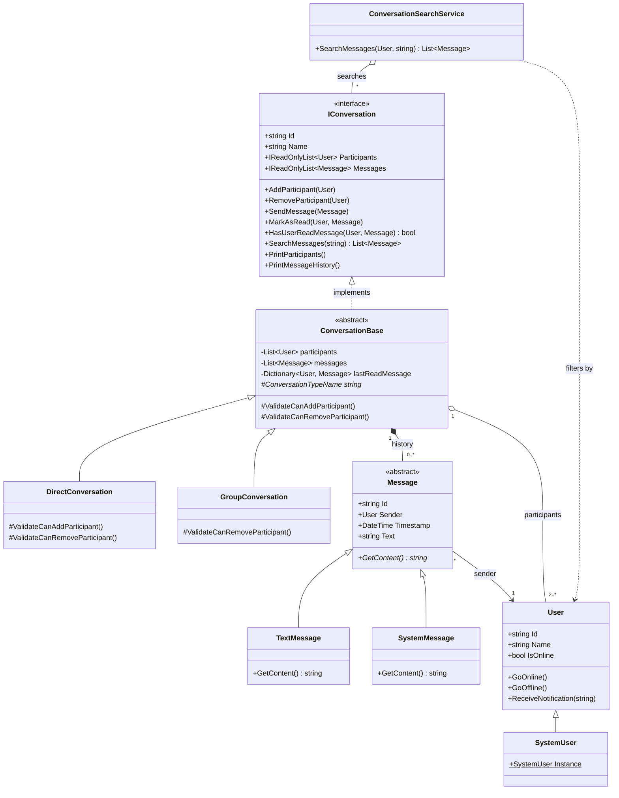

# Chat Application (Client-Server Simulation)

Course: Object-Oriented Programming (OOP) · Semester 1, 2026-2027 · Instructor: Huỳnh Xuân Phụng

> **Important:** message delivery and "real-time" notifications are **simulated
> inside a single process**. The project uses no sockets and no real network.
> How to extend the design to a real client-server system is described in
> [section 8](#8-extending-to-a-real-client-server-architecture).

## 1. Problem Restatement

Build the core object model of a chat application: users, one-to-one and group
conversations, and message history. Requirements:

1. Model `User`, `Conversation` (Direct and Group share one interface) and `Message`.
2. Simulate message delivery: append to the conversation history and notify online participants.
3. Support read receipts: one "last read message" pointer per user per conversation.
4. Support at least one message type beyond plain text (here: `SystemMessage`).
5. Search for messages containing a keyword across all of a user's conversations.

OOP principles to demonstrate: **Polymorphism**, **Composition**,
**Encapsulation** (the project also uses Inheritance and Abstraction).

## 2. Implemented Features

| Requirement | Status | Where |
|---|---|---|
| User, Conversation, Message | Done | `User`, `IConversation`, `ConversationBase`, `Message` |
| Direct and Group behind a shared interface | Done | `DirectConversation`, `GroupConversation` |
| Send message, store history, notify online users | Done | `ConversationBase.SendMessage`, `User.ReceiveNotification` |
| Per-user, per-conversation read receipts | Done | `ConversationBase.MarkAsRead`, `HasUserReadMessage` |
| Non-text message type | Done (`SystemMessage`) | `SystemMessage`, `SystemUser` |
| Search within one conversation | Done | `ConversationBase.SearchMessages` |
| Search across all of a user's conversations | Done | `ConversationSearchService.SearchMessages` |
| Add participant | Done | `ConversationBase.AddParticipant` |
| Leave group / remove participant | Done | `ConversationBase.RemoveParticipant` |
| Input and operation validation | Done | See section 6 |

## 3. Project Structure

```text
ChatApplication/
├── Program.cs                     # Demo scenario and console tests
├── User.cs                        # User, online/offline state, receives notifications
├── SystemUser.cs                  # Singleton system identity that signs SystemMessage
├── Message.cs                     # Abstract base for all messages
├── TextMessage.cs                 # Plain text message
├── SystemMessage.cs               # System event message
├── IConversation.cs               # Shared interface of all conversations
├── ConversationBase.cs            # Shared conversation logic
├── DirectConversation.cs          # One-to-one chat (exactly 2 people, nobody may leave)
├── GroupConversation.cs           # Group chat (at least 2 people)
├── ConversationSearchService.cs   # Search across multiple conversations
├── ChatApplication.csproj
└── README.md
```

## 4. UML Class Diagram

GitHub renders the `mermaid` block below as a diagram when you view this README
on the repository page.



Notation: `<|--` inheritance, `<|..` interface implementation, `*--`
composition, `o--` aggregation, `-->` association, `..>` dependency.

## 5. Self-Explanation

### 5.1 Per requirement

1. **User, Conversation, Message.** `User` holds identity and online state
   (changed only through `GoOnline()` / `GoOffline()`). `IConversation` is the
   shared contract. `Message` is an abstract class carrying the common data
   (Id, Sender, Timestamp, Text).
2. **Delivery and notification.** `ConversationBase.SendMessage` validates the
   message (not null, unique Id, sender is a participant), appends it to the
   history, then calls `ReceiveNotification` on the other participants.
   `User.ReceiveNotification` only shows the notification when the user is online.
3. **Read receipts.** `ConversationBase` keeps `lastReadMessage` (one pointer per
   user). `MarkAsRead` only moves the pointer forward, so reading the third
   message means the first and second are read too. `HasUserReadMessage`
   compares a message's position with the pointer.
4. **New message type.** `SystemMessage` represents events such as "X joined the
   group". Only `SystemUser.Instance` can sign it, so a normal user cannot forge
   a system event.
5. **Search.** `ConversationBase.SearchMessages` searches one conversation
   (case-insensitive). `ConversationSearchService` filters the conversations the
   user takes part in and merges the results.

### 5.2 Per OOP principle

**Polymorphism**
- Where: `IConversation` with `DirectConversation` / `GroupConversation`; the
  hooks `ValidateCanAddParticipant()` and `ValidateCanRemoveParticipant()`; and
  `Message.GetContent()` with `TextMessage` / `SystemMessage`.
- Why it fits: `AddParticipant` and `RemoveParticipant` are the same operation
  with different rules. A direct chat rejects a third person and does not allow
  leaving; a group accepts new people and only forbids leaving when two members
  remain. Using overridden hooks means `ConversationBase` needs no
  `if (this is DirectConversation)` checks, and a new conversation type can be
  added without editing existing code. `ConversationSearchService` only knows
  `IConversation`, so it works with every conversation type.

**Composition**
- Where: `ConversationBase` owns its list of `Message` objects (the history) and
  its list of participant `User` objects.
- Why it fits: a conversation's messages have no meaning without that
  conversation, so the history belongs to it (composition). A `User` exists
  independently and can be in many conversations, so the relationship to
  participants is aggregation. `ConversationSearchService` is built from a list
  of `IConversation` instead of inheriting from anything.

**Encapsulation**
- Where: `lastReadMessage`, `participants` and `messages` are `private` in
  `ConversationBase`; the outside only sees `IReadOnlyList`. `User.IsOnline`
  has a `private set`.
- Why it fits: if outside code could edit the lists or the read pointer, it
  could add a message without the sender check, or move the pointer backwards,
  breaking the rule that a read receipt cannot be undone. Every change must go
  through `SendMessage`, `AddParticipant`, `RemoveParticipant` or `MarkAsRead`,
  so the validation always runs.

**Inheritance and Abstraction (additional)**
- `ConversationBase` collects the shared logic (history, notifications, read
  receipts, search); the subclasses only declare their own rules.
- `Message` is an abstract class with the abstract method `GetContent()`.

### 5.3 Extensibility

- New conversation type (e.g. a broadcast channel): inherit `ConversationBase`
  and override the hooks; no existing class changes.
- New message type (e.g. `ImageMessage`): inherit `Message` and override
  `GetContent()`. Not implemented in this project.
- Acknowledged weakness: `ConversationBase` has quite a few responsibilities
  (history, notifications, read receipts, console printing). A possible
  improvement is extracting a `ReadReceiptTracker` class that
  `ConversationBase` contains.

## 6. Testing and Evidence

The tests are console checks in `Program.cs`; each prints `[PASS]` or `[FAIL]`.
There is no separate unit-test project yet.

| Test | Content | Type |
|---|---|---|
| 0 | Inheritance: `TextMessage` and `SystemMessage` share `Message` state | Polymorphism / inheritance |
| 0A | Encapsulation: user state and collections cannot be mutated from outside | Encapsulation |
| 1 | Reject an empty message | Validation error |
| 2 | Reject a sender who is not a participant | Validation error |
| 3 | Message history | Happy path |
| 4 | Read receipt | Happy path |
| 5 | Search within one conversation | Happy path |
| 6, 6A, 6B, 6C | Cross-conversation search, participation filter, case-insensitivity, input validation | Happy path and errors |
| 7 | Group conversation | Happy path |
| 8 | Notifications for online/offline users | Happy path |
| 9, 9A | Polymorphism through `IConversation`: Direct and Group have different add-participant rules | Polymorphism |
| 9B | Leaving: Direct rejects, Group accepts, Group rejects at 2 members, history preserved | Polymorphism and errors |
| 10 | `SystemMessage` | Happy path |
| 11 | Reject a `SystemMessage` signed by a normal user | Validation error |
| 12 | Last-read pointer only moves forward | Validation |

Run `dotnet run` and attach the output to the report as evidence. To list failed
tests only:

```powershell
dotnet run | Select-String "FAIL"
```

If nothing is printed, no test failed.

## 7. Build and Run

Requirement: .NET SDK 10 (`net10.0`).

```powershell
dotnet build
dotnet run
```

The program prints the demo scenario (users, Direct and Group conversations,
history, search, read receipts) and then runs the tests in order.

## 8. Extending to a Real Client-Server Architecture

This section is a description only; it is not implemented.

- **Separate the transport layer:** replace the direct call
  `participant.ReceiveNotification` with an interface such as
  `IMessageTransport` / `INotifier`. The current version is in-process; a real
  version sends over the network.
- **Server:** an ASP.NET Core application (SignalR or WebSocket) that hosts the
  `IConversation` objects. Each connected client is a session bound to a `User`;
  after `SendMessage` succeeds, the server pushes the message to the connections
  of online users.
- **Client:** sends commands (send message, mark as read, leave group) to the
  server and receives pushed events.
- **Protocol:** serialize messages as JSON DTOs; each message carries a `type`
  field so the correct subclass is chosen when decoding.
- **Persistence:** replace the in-memory lists with a repository (for example a
  database) so history survives a restart.
- **Authentication and concurrency:** add login so the server knows who the
  `Sender` is, and use a lock or a per-conversation queue so concurrent messages
  keep a consistent order.
- **Offline messages:** store undelivered notifications and replay them when the
  user comes online.

## 9. Current Limitations

- Data is stored in memory only.
- No real networking; everything runs in one process.
- No automated unit-test project yet (console tests are used instead).
- No `ImageMessage`; the only non-text message type is `SystemMessage`.
- No user registry, so non-existent user IDs are not checked.
- The "left the group" event in the main demo scenario is still a simulated
  system message; the real leave operation is `RemoveParticipant` (see test 9B).
  The system does not automatically generate a `SystemMessage` when someone
  joins or leaves.
- Some test data uses Vietnamese text without diacritics; it has not been
  standardized.

## 10. AI Usage Log

Adjust this table to match how you actually used AI before submitting.

| Date | Tool | Purpose / prompt summary | Result used | How it was verified |
|---|---|---|---|---|
| 2026-10-26 | GitHub Copilot | Review what the project is missing | List of missing items | Compared against the assignment |
| 2026-10-26 | GitHub Copilot | Add `RemoveParticipant` and test 9B | Code and test | `dotnet run`, test 9B reports PASS |
| 2026-10-26 | GitHub Copilot | Draw Mermaid UML, rewrite README | Diagram and README | Viewed on GitHub, compared against the code |

## 11. Oral Defense Preparation

Possible questions:
- Why use both the `IConversation` interface and the `ConversationBase` class?
- Why is `SystemUser` not a participant but can still send messages?
- Why does the read pointer only move forward?
- Which classes must change to add `ImageMessage` or a broadcast channel?
- Why might `ConversationBase` be seen as a God class, and how would you split it?
